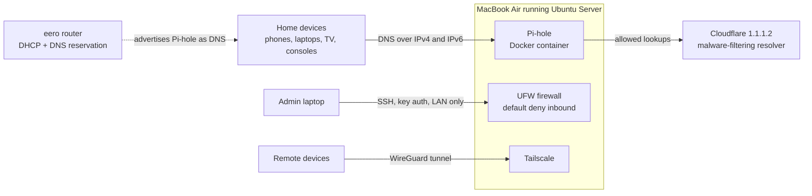

# Homelab: Repurposed MacBook Air as a Hardened Network Server

I turned an unused MacBook Air into a headless Ubuntu server that filters DNS for every device on my home network, blocks ads, trackers, malware, and phishing domains, and is reachable remotely without exposing a single port to the internet.

This repo documents the build, the security decisions behind it, and the problems I had to solve along the way.

## At a Glance

| | |
|---|---|
| **Hardware** | MacBook Air, Intel Core i5, 8 GB RAM, 128 GB SSD (repurposed, previously unused) |
| **OS** | Ubuntu Server 26.04 LTS, headless, managed over SSH |
| **Services** | Docker, Pi-hole (network-wide DNS filtering), Tailscale (remote access) |
| **Network** | eero mesh router handing out Pi-hole as DNS over both IPv4 and IPv6 |
| **Security** | Key-only SSH, default-deny host firewall, no port forwarding, automatic security updates, threat-intel blocklists |

## Architecture



## What I Built

1. **Bare-metal install.** Wiped macOS and installed Ubuntu Server from a USB installer I flashed myself.
2. **Networking and drivers.** Brought the machine online with no Ethernet port and no in-box Wi-Fi driver, then installed the correct Broadcom driver and configured Wi-Fi with netplan.
3. **Containerized services.** Installed Docker and deployed Pi-hole with Docker Compose so the service is isolated and easy to update or rebuild.
4. **Network-wide DNS filtering.** Pointed the router's DHCP DNS at Pi-hole for both IPv4 and IPv6 so every device on the network is covered without per-device setup.
5. **Remote access without port forwarding.** Used Tailscale (WireGuard) instead of opening ports on the router.
6. **Security hardening.** Locked down SSH, enabled a host firewall, enabled automatic security updates, and kept secrets out of version control.

## Security Hardening

| Control | Implementation | Why |
|---|---|---|
| SSH authentication | ed25519 keys only; password and keyboard-interactive auth disabled; root login disabled | Removes password brute forcing as an attack path entirely |
| SSH config precedence | Hardening file named `00-hardening.conf` so it loads before Ubuntu's default drop-ins | In `sshd_config.d`, the first value read wins; a later file would have been silently overridden. Verified with `sshd -T` |
| Host firewall | UFW with default deny inbound; SSH allowed only from the LAN subnet; Tailscale interface allowed; DNS over IPv6 allowed only from the local ULA range | Least privilege: only the traffic each service actually needs |
| Internet exposure | Zero port forwards on the router | Nothing on the server is reachable from the public internet |
| Remote access | Tailscale (WireGuard), with key expiry disabled for the server only | Encrypted, authenticated access from anywhere without opening ports |
| Patching | `unattended-upgrades` for automatic security updates, plus a monthly manual update routine | Closes known vulnerabilities quickly |
| DNS-layer threat blocking | HaGeZi Threat Intelligence Feeds blocklist plus Cloudflare's malware-filtering upstream (1.1.1.2) | Two independent layers blocking malware, phishing, and command-and-control domains |
| DNS bypass prevention | HaGeZi encrypted DNS (DoH) blocklist | Stops apps and smart TVs from silently routing around the network's DNS policy |
| Secrets management | Pi-hole password loaded from a `.env` file excluded by `.gitignore` | Credentials never land in the repo |
| Backups | Pi-hole Teleporter exports after configuration changes | Fast recovery if the server or container is rebuilt |

## Blocklist Strategy

The goal was maximum blocking without breaking gaming consoles or streaming services.

| List | Purpose |
|---|---|
| [HaGeZi Multi PRO](https://github.com/hagezi/dns-blocklists) | Ads, trackers, telemetry. Chosen over more aggressive tiers because its maintainer rates breakage as low |
| HaGeZi Threat Intelligence Feeds (medium) | Malware, phishing, scams, cryptojacking |
| HaGeZi encrypted DNS | Blocks DNS over HTTPS providers to prevent bypass |

I replaced Pi-hole's default StevenBlack list with HaGeZi PRO, which covers it and is more actively maintained. I deliberately avoided the Pro++ and Ultimate tiers, which the maintainer notes can break things like Xbox Live features.

**A note on testing:** after the switch, the bare `doubleclick.net` domain was no longer blocked. Rather than assume something was broken, I compared IPv4 and IPv6 results and tested an actual ad-serving subdomain (`googleads.g.doubleclick.net`), which was blocked. The root domain is intentionally left resolvable so clicking sponsored search results still works.

**Known limitation:** DNS filtering cannot block ads that streaming platforms (YouTube, Prime Video, Paramount+) stitch into the video stream from the same servers that deliver the content. Those require client-side blocking or ad-free plans.

## Troubleshooting Log

The most useful learning came from the problems.

### 1. No network during install
The MacBook Air has no Ethernet port, and Ubuntu does not ship a driver for its Broadcom BCM4360 Wi-Fi chip. I completed the install offline, then brought the server online through iPhone USB tethering by writing a netplan config that matches any wired interface (`name: "e*"`). That same config later picks up a USB Ethernet adapter automatically.

### 2. Driver package not found
`bcmwl-kernel-source` returned "Unable to locate package" on Ubuntu 26.04. I identified the chip with `lspci -nn`, enabled the `restricted` and `multiverse` repository components, and searched with `apt-cache search` to find the replacement package, `broadcom-sta-dkms`. DKMS built the module for both installed kernels. A reboot was needed so the conflicting open-source drivers released the hardware.

### 3. Wi-Fi would not associate
The interface sat in a `DORMANT` state. A wireless scan with `iw` showed the network name did not exactly match my netplan config. Fixing the SSID brought the interface up with a DHCP lease.

### 4. Port 53 already in use
Ubuntu's `systemd-resolved` stub listener occupies port 53, which Pi-hole needs. I disabled the stub listener and relinked `/etc/resolv.conf` to the full resolver file so the host itself could still resolve names.

### 5. Router refused custom DNS
The eero would not accept a custom DNS server while its built-in security features were enabled. I disabled them and replaced that protection with the threat-intel blocklist and a malware-filtering upstream resolver, so no protection was lost.

### 6. IPv6 DNS gap
Clients could still ask the router's IPv6 DNS and bypass Pi-hole. I confirmed Pi-hole answered over IPv6 with `dig`, added a firewall rule allowing DNS only from the local ULA range, and published the server's IPv6 address as the network's IPv6 DNS server.

### 7. Docker and UFW interaction
Docker manages its own iptables rules for published ports, which means those ports can bypass UFW. I treated this as a known risk and mitigated it at the network edge: the router forwards no ports, so Pi-hole's ports are only reachable from inside the home network.

## Verification

Run from a client on the network:

```bash
# Pi-hole answers normal queries
dig google.com @<server-ip>

# Known ad-serving domain returns 0.0.0.0
dig googleads.g.doubleclick.net @<server-ip>

# Same checks over IPv6
dig googleads.g.doubleclick.net @<server-ipv6>
```

Run on the server:

```bash
# Confirm SSH password auth is off
sudo sshd -T | grep -i passwordauthentication

# Confirm firewall rules
sudo ufw status verbose
```

## Maintenance

Monthly:

```bash
# Update Pi-hole
cd ~/pihole
docker compose pull
docker compose up -d

# Update the OS, Docker, and Tailscale
sudo apt update && sudo apt full-upgrade -y
```

Then export a fresh Teleporter backup from the Pi-hole dashboard.

## Repo Layout

```
.
├── README.md
├── pihole/
│   ├── docker-compose.yml     # Pi-hole service definition
│   └── .env.example           # Template for the admin password
└── config/
    ├── ssh/00-hardening.conf  # SSH hardening drop-in
    ├── netplan/01-netcfg.example.yaml
    └── firewall.sh            # UFW rules
```

## Skills Demonstrated

- **Linux administration:** bare-metal install, kernel modules and DKMS, systemd, package repositories
- **Networking:** DNS, DHCP reservations, IPv4 and IPv6, netplan, Wi-Fi configuration, mesh router management
- **Security:** SSH hardening, host firewalling, attack surface reduction, DNS-layer threat blocking, secrets management
- **Containers:** Docker, Docker Compose, persistent volumes
- **Troubleshooting:** isolating issues layer by layer and verifying fixes with evidence

## Roadmap

- [ ] USB Ethernet adapter for wired reliability
- [ ] Uptime Kuma for service monitoring and alerts
- [ ] Encrypt upstream DNS (DNS over HTTPS via cloudflared, or a local Unbound resolver)
- [ ] Self-hosted photo backup with Immich on external storage
- [ ] Active Directory and Wazuh SIEM lab on a dedicated mini PC
